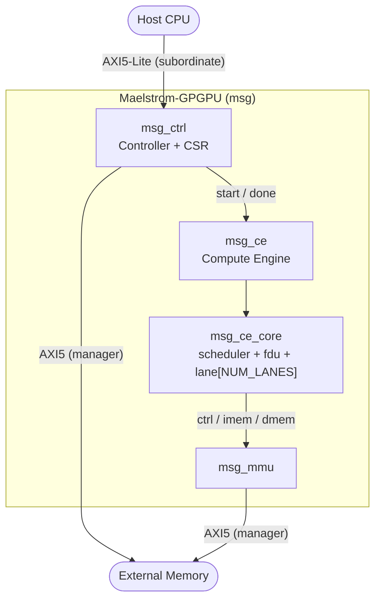

# Maelstrom-GPGPU

[](LICENSE)
[](https://verilator.org)
[](#development-status-and-roadmap)

maelstrom
/māl'strəm/

noun

1. A powerful, high-velocity whirlpool created when opposing currents force fluid to revolve rapidly around a central axis.
"a massive tidal maelstrom off the coast."

2. An open-source RISC-V SIMT GPGPU microarchitecture that funnels massive parallel thread execution through a high-throughput hardware pipeline.
"scaling thread blocks on the Maelstrom-GPGPU core."

## Table of Contents
[Project Overview](#project-overview)

[Architecture Overview](#architecture-overview)

[Repository Structure](#repository-structure)

[Development Status and Roadmap](#development-status-and-roadmap)

[Getting Started](#getting-started)
- [Prerequisites](#prerequisites)
- [Environment Setup](#environment-setup)
- [Targets](#targets)
- [Design Parameters](#design-parameters)
- [Adding a Testbench](#adding-a-testbench)
- [Running Simulations](#running-simulations)

[Contributing](#contributing)

[License](#license)

[Acknowledgements](#acknowledgements)

## Project Overview
Maelstrom-GPGPU (MSG) is an open-source Single Instruction Multiple Threads (SIMT) General-Purpose Graphics Processing Unit (GPGPU) accelerator designed as a custom hardware implementation for EECS 627 (Advanced VLSI Design) at the University of Michigan. MSG is built to output clean RTL ready for end-to-end ASIC synthesis, placement, routing, timing closure, and power analysis. Built on top of the Vortex GPGPU research platform, it extends the standard 32-bit RISC-V (RV32I) ISA with basic SIMT execution mechanisms—including a primary warp scheduler, fundamental thread divergence control (tmc, wspawn, split, join), and dual AXI5 interfaces (an AXI5-Lite subordinate for host CPU CSR control and a Full AXI5 manager for memory transfers).

## Architecture Overview

MSG is organized as a top-level system (`maelstrom_gpgpu`) that hosts a compute engine, a host-facing controller, and a memory management unit.
The compute engine contains one or more SIMT compute cores, each with a warp scheduler, a fetch-decode unit, and a vector of SIMD lanes.



At the core level, three SystemVerilog interfaces carry launch control (`ctrl`), instruction fetches (`imem`), and per-lane data accesses (`dmem`).
Each interface provides `core`, peer, and `monitor` modports and uses a valid/ready handshake.

| Interface | Purpose |
| :-------- | :------ |
| `msg_ce_core_ctrl_if` | `start`/`done` handshake plus `warp_id` and `thread_cnt`. |
| `msg_ce_core_imem_if` | Instruction fetch request/response. |
| `msg_ce_core_dmem_if` | Per-lane data memory read/write. |

MSG implements RV32I and adds SIMT control instructions (`tmc`, `wspawn`, `split`, `join`) under the Vortex opcode.
See `docs/architecture.md` for the core FSM, interface contracts, divergence model, and memory system.

## Repository Structure

```
maelstrom-gpgpu/
├── rtl/            SystemVerilog design sources
│   ├── msg.sv            Top-level module
│   ├── msg_pkg.sv        Global types and ISA encodings
│   ├── msg_ce/           Compute engine and compute cores
│   ├── msg_ctrl/         Controller and CSR block
│   └── msg_mmu/          Memory management unit
├── tb/             Testbenches (one directory per top-level TB)
│   └── core_tb/          Compute core testbench
├── scripts/        Build and code-generation scripts
├── inputs/         Design parameter inputs (YAML)
├── docs/           Project documentation
├── ip/             External and vendor IP (reserved)
├── sim/            Simulation build output (generated)
└── reports/        Simulation and synthesis reports (generated)
```

Run `make rtl` and `make tb` to print the RTL and testbench trees with module descriptions.

## Development Status and Roadmap

MSG is developed in phases, each with a milestone label, a set of deliverables, and measurable acceptance criteria.
Milestone labels are placeholders until delivery targets are scheduled.

### Status Legend
- `[DONE]`: Complete and merged.
- `[WIP]`: In progress.
- `[TODO]`: Not started.
- `[BLOCKED]`: Waiting on a dependency.

### Phase Overview

| Phase | Milestone | Status | Summary |
| :---- | :-------- | :----- | :------ |
| 0. Scaffolding and Tooling | M0 - Build System Ready | `[DONE]` | Repository, build system, and simulation flow. |
| 1. Baseline Single-Warp Core Bring-Up | M1 - Single-Warp Functional | `[CURRENT]` | One warp executes RV32I through a single compute core. |
| 2. Full SIMT and Multi-Warp Interleaving | M2 - Multi-Warp SIMT | `[TODO]` | Multiple resident warps with interleaved issue and divergence control. |
| 3. Memory Hierarchy and MMU | M3 - Coherent Memory System | `[TODO]` | Caches, coalescing, and virtual memory translation. |
| 4. System Integration | M4 - Full Accelerator | `[TODO]` | Compute engine, controller, CSR, and dual AXI5 interfaces. |
| 5. Verification and Programming Model | M5 - Verification Sign-off | `[TODO]` | Coverage, regression, and software runtime. |
| 6. Physical Design | M6 - Physical Sign-off | `[TODO]` | Synthesis, APR, timing closure, and power. |

### Phase 0: Scaffolding and Tooling
- **Milestone:** M0 - Build System Ready
- **Status:** `[DONE]`

**Goal:** Establish the repository, build system, and simulation flow required to develop and verify RTL.

**Deliverables:**
- `[DONE]` Repository layout (`rtl/`, `tb/`, `scripts/`, `inputs/`, `docs/`, `ip/`).
- `[DONE]` Environment setup script (`setup.sh`).
- `[DONE]` Top-level `Makefile` with per-testbench simulation targets (`%.sim`).
- `[DONE]` Verilator lint and simulation flow (`scripts/verilator.f`).
- `[DONE]` YAML-driven parameter generation (`inputs/msg_params.yaml` -> `scripts/gen_param_pkg.py` -> `rtl/msg_params_pkg.sv`).
- `[DONE]` RTL and testbench tree viewer (`scripts/view_dir.py`).
- `[TODO]` `make lint` target and continuous integration.

**Acceptance Criteria:**
- `source setup.sh && make core_tb.sim` elaborates and runs without errors.
- `make help` lists all available targets.

### Phase 1: Baseline Single-Warp Core Bring-Up
- **Milestone:** M1 - Single-Warp Functional
- **Status:** `[CURRENT]`

**Goal:** Execute a single warp through one compute core with a correct RV32I datapath and memory path.

**Deliverables:**
- `[DONE]` Core packages and types (`msg_pkg`, `msg_ce_core_pkg`).
- `[DONE]` Core interfaces and modports (`ctrl`, `imem`, `dmem`).
- `[WIP]` Core top-level FSM (`msg_ce_core.sv`: states defined, transitions pending).
- `[TODO]` Fetch-Decode Unit (`msg_ce_core_fdu.sv`).
- `[TODO]` Lane datapath and register file (`msg_ce_core_lane.sv`).
- `[TODO]` Single-warp scheduler with scoreboarding and RAW hazard stalls (`msg_ce_core_scheduler.sv`).
- `[TODO]` Load/Store Unit over `dmem_if`, including lane memory ordering.
- `[TODO]` Intra-warp branch and jump handling with PC redirect.
- `[TODO]` Directed RV32I tests and a self-checking testbench.

**Acceptance Criteria:**
- One warp executes a directed RV32I program (arithmetic, load/store, branch) with correct architectural state.
- The `ctrl`, `imem`, and `dmem` handshakes are exercised and verified.

### Phase 2: Full SIMT and Multi-Warp Interleaving
- **Milestone:** M2 - Multi-Warp SIMT
- **Status:** `[TODO]`

**Goal:** Support multiple resident warps per compute core with interleaved issue and SIMT divergence control.

**Deliverables:**
- `[TODO]` Per-warp context (PC, active mask, status) and register file banking.
- `[TODO]` Warp scheduling policies (round-robin, greedy-then-oldest).
- `[TODO]` Interleaved issue for latency hiding across warps.
- `[TODO]` SIMT divergence control: `tmc`, `wspawn`, `split`, `join`.
- `[TODO]` IPDOM reconvergence stack.
- `[TODO]` Divergence and multi-warp directed tests.

**Acceptance Criteria:**
- N warps interleave on one core without corrupting each other's state.
- Divergent if/else and loop kernels reconverge and produce correct results.

### Phase 3: Memory Hierarchy and MMU
- **Milestone:** M3 - Coherent Memory System
- **Status:** `[TODO]`

**Goal:** Provide a coherent memory path with caches and address translation.

**Deliverables:**
- `[TODO]` Separate instruction and data caches.
- `[TODO]` Load/Store Unit coalescing and per-lane memory ordering.
- `[TODO]` Miss-status handling registers (MSHRs) and outstanding-request tracking.
- `[TODO]` MMU with TLB and page-table walk (`msg_mmu`).
- `[TODO]` Cache and translation directed tests.

**Acceptance Criteria:**
- Cached and uncached accesses are functionally equivalent.
- Coalescing is verified against a reference model.
- Virtual-to-physical translation matches a software reference.

### Phase 4: System Integration
- **Milestone:** M4 - Full Accelerator
- **Status:** `[TODO]`

**Goal:** Assemble the full accelerator from the compute engine, controller, CSR, and AXI5 interfaces.

**Deliverables:**
- `[TODO]` Compute Engine with multiple compute cores (`msg_ce`).
- `[TODO]` Controller and CSR block (`msg_ctrl`, `msg_ctrl_csr`).
- `[TODO]` AXI5-Lite subordinate for host CSR control.
- `[TODO]` Full AXI5 manager for memory transfers.
- `[TODO]` L2/memory model, reset, and clocking.
- `[TODO]` Top-level integration (`msg`).

**Acceptance Criteria:**
- The full top-level design elaborates and simulates.
- A host can program the CSR block and launch a kernel.
- AXI5 read and write transactions are verified against the protocol.

### Phase 5: Verification and Programming Model
- **Milestone:** M5 - Verification Sign-off
- **Status:** `[TODO]`

**Goal:** Achieve verification sign-off and provide a usable software programming path.

**Deliverables:**
- `[TODO]` Unit, integration, and constrained-random tests.
- `[TODO]` Functional coverage and SystemVerilog assertions.
- `[TODO]` Regression and continuous integration.
- `[TODO]` Runtime/driver and example kernels.

**Acceptance Criteria:**
- Coverage goals are met and the regression is green.
- An ISA test suite passes.
- The runtime and example kernels are documented.

### Phase 6: Physical Design
- **Milestone:** M6 - Physical Sign-off
- **Status:** `[TODO]`

**Goal:** Close the design through an end-to-end ASIC flow.

**Deliverables:**
- `[TODO]` Synthesis (`make clean_synth` and synthesis targets).
- `[TODO]` Floorplan and placement.
- `[TODO]` Clock tree synthesis and routing.
- `[TODO]` Static timing analysis and timing closure.
- `[TODO]` Power analysis.

**Acceptance Criteria:**
- Timing closes at the target frequency for the selected PDK.
- DRC and LVS are clean.
- A power report is generated.

### Future and Stretch Work
- FP32 support and additional ISA extensions.
- Banked register files and operand collectors.
- Multi-level caches and prefetching.
- Performance counters and profiling.

## Getting Started

### Prerequisites
- Verilator 5.x (developed against 5.037).
- Python 3 with PyYAML (parameter generation and the directory-tree viewer).
- GNU Make and a POSIX shell.

### Environment Setup
Before using the build system, view `setup.sh` and its contents, then run `source setup.sh` to populate the required environment variables.
The script exports the project root, source directories (`RTL_DIR`, `TB_DIR`, `SCRIPTS_DIR`, `INPUTS_DIR`), generated-output directories (`SIM_DIR`, `REPORTS_DIR`, `SYNTH_DIR`, `APR_DIR`), and the simulator selection (`SIM`, `SIM_OPTS`).
The top-level `Makefile` aborts if these variables are not set, so source the script in every new shell.

### Targets
Run `make` or `make help` to display the available make targets.

| Target | Description |
| :----- | :---------- |
| `help` | List all targets (default). |
| `rtl` | Print the RTL directory tree with module descriptions. |
| `tb` | Print the testbench directory tree with descriptions. |
| `<tb>.sim` | Elaborate and run testbench `<tb>` (for example `core_tb.sim`). |
| `msg_params_pkg.sv` | Regenerate the parameter package from YAML. |
| `clean` | Delete simulation builds and reports. |
| `clean_synth` | Delete synthesis outputs. |
| `clean_apr` | Delete APR outputs. |

`clean_synth` and `clean_apr` are placeholders for the Phase 6 physical-design flow.

### Design Parameters
Design parameters are defined in `inputs/msg_params.yaml` and generated into `rtl/msg_params_pkg.sv` by `scripts/gen_param_pkg.py`.
The generator flattens nested keys into upper-case macros (for example `msg.ce.core.num_warps` becomes `CE_CORE_NUM_WARPS`), which the RTL consumes through `msg_params_pkg` and `msg_pkg`.

| Parameter | Path | Meaning |
| :-------- | :--- | :------ |
| `num_warps` | `msg.ce.core` | Resident warps per compute core. |
| `num_lanes` | `msg.ce.core` | SIMD lanes (threads) per warp. |

To change a parameter, edit the YAML and regenerate with `make msg_params_pkg.sv`.
The package is regenerated automatically as a prerequisite of `%.sim`.

### Adding a Testbench
Testbenches live in `tb/<name>/` and follow the `core_tb` layout:

1. Create `tb/<name>/<name>.sv` and name its top module `<name>`.
2. Create `tb/<name>/<name>.f` listing the design and testbench sources, then set the top module with `--top-module <name>`.
3. Run `make <name>.sim`.

The `%.check` rule requires `tb/<name>/<name>.f` to exist, and the `%.sim` rule elaborates the design into `sim/<name>/` and runs the resulting executable.

### Running Simulations
Run a testbench with `make <name>.sim`, for example `make core_tb.sim`.
Verilator elaborates the design into `sim/<name>/`, and the testbench executable writes its output to `reports/<name>/verilator.log`.
Waveforms are dumped in FST format (enabled by `--trace-fst` and `--trace-structs` in `scripts/verilator.f`).
The current `core_tb` harness resets the core and finishes after a fixed number of cycles; self-checking and scoreboards arrive with the Phase 1 deliverables.

## Contributing
- Keep RTL sources in `rtl/` and testbenches in `tb/`, one directory per module or testbench.
- Add new source files to the relevant `.f` filelist.
- Follow the existing file headers, naming (`msg_<block>_<unit>`), and interface/modport conventions.
- Keep simulations green before opening a pull request, and do not commit generated outputs (`sim/`, `reports/`, `synth/`, `apr/`).

## License
Licensed under the Apache License, Version 2.0. See `LICENSE` for the full text.

## Acknowledgements
- Built on the [Vortex GPGPU](https://github.com/vortexgpgpu/vortex) research platform.
- Developed as a custom hardware implementation for EECS 627 (Advanced VLSI Design) at the University of Michigan.

