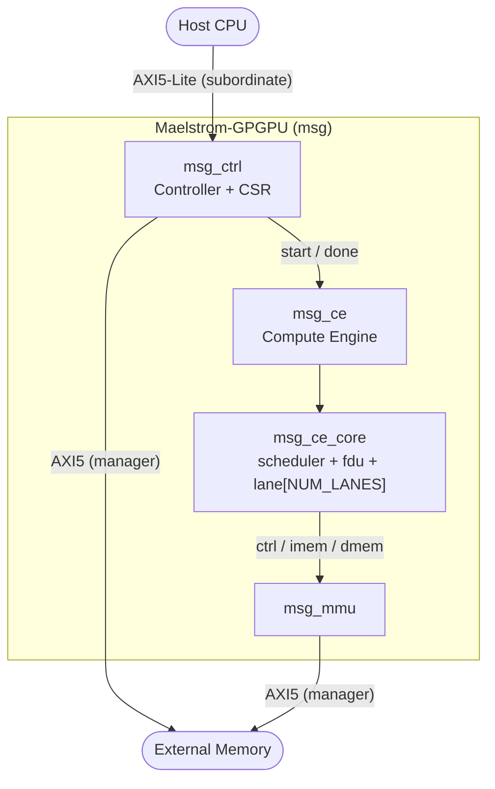
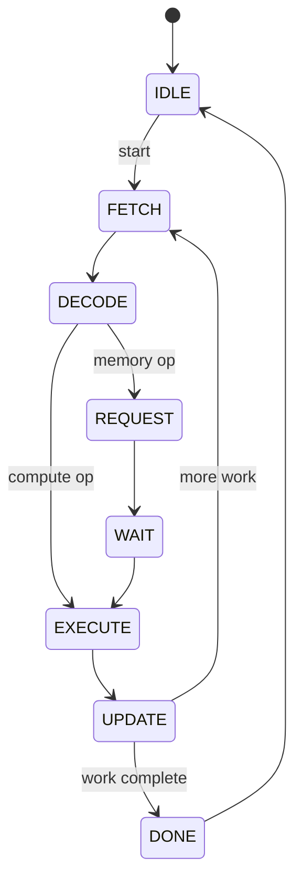

# Architecture

This document describes the Maelstrom-GPGPU (MSG) microarchitecture.
Sections note whether a block is implemented, in progress, or intended design so the document remains useful while the RTL is under construction.
For build instructions, see the top-level `README.md`.

## Overview

MSG is a Single Instruction Multiple Threads (SIMT) accelerator organized as a top-level system that hosts a compute engine, a host-facing controller, and a memory management unit.
The compute engine contains one or more compute cores, each of which issues a single instruction across a vector of SIMD lanes for every active thread in a warp.

The host programs the controller over an AXI5-Lite subordinate interface.
The controller launches work on the compute engine and, together with the MMU, moves data to and from external memory over Full AXI5 manager interfaces.

## Module Hierarchy

| Module | Path | Status | Responsibility |
| :----- | :--- | :----- | :------------- |
| `maelstrom_gpgpu` | `rtl/msg.sv` | Skeleton | Top-level integration. |
| `msg_ce` | `rtl/msg_ce/msg_ce.sv` | Skeleton | Compute engine holding the compute cores. |
| `msg_ce_core` | `rtl/msg_ce/msg_ce_core/msg_ce_core.sv` | In progress | SIMT compute core (scheduler, fetch-decode, lanes). |
| `msg_ctrl` | `rtl/msg_ctrl/msg_ctrl.sv` | Intended | Controller and host interface. |
| `msg_ctrl_csr` | `rtl/msg_ctrl/msg_ctrl_csr.sv` | Intended | Control and status registers. |
| `msg_mmu` | `rtl/msg_mmu/msg_mmu.sv` | Intended | Address translation and memory interface. |

Global definitions live in `rtl/msg_pkg.sv` (address, data, thread, and instruction types) and design parameters in the generated `rtl/msg_params_pkg.sv`.

## Compute Core

The compute core (`msg_ce_core`) is a SIMT execution unit that fetches one instruction per warp, decodes it once, and executes it across all lanes of a warp.

### Core FSM

**Status:** In progress.
The state enumeration is defined in `msg_ce_core_pkg.sv`; the transitions and datapath actions are not yet implemented.

States:

| State | Meaning |
| :---- | :------ |
| `CORE_STATE_IDLE` | Waiting for a launch from the controller. |
| `CORE_STATE_FETCH` | Request the next instruction for the active warp. |
| `CORE_STATE_DECODE` | Decode the fetched instruction and read source operands. |
| `CORE_STATE_REQUEST` | Issue a memory request when the instruction requires it. |
| `CORE_STATE_WAIT` | Wait for a memory response. |
| `CORE_STATE_EXECUTE` | Execute across the lanes. |
| `CORE_STATE_UPDATE` | Write back results and update architectural state. |
| `CORE_STATE_DONE` | Signal completion of the current work. |

The `DONE` transition and the loop back to `FETCH` are intended behavior and will be finalized as the FSM is implemented.

### Core Interfaces

The core exposes three SystemVerilog interfaces, each with `core`, peer, and `monitor` modports.
Handshakes follow a valid/ready convention, with a `*_fire()` function defined on each interface that returns true when a transfer occurs.

| Interface | File | Signals | Purpose |
| :-------- | :--- | :------ | :------ |
| `msg_ce_core_ctrl_if` | `msg_ce_core_ctrl_if.sv` | `start`, `done`, `warp_id`, `thread_cnt` | Launch control from the controller. |
| `msg_ce_core_imem_if` | `msg_ce_core_imem_if.sv` | `req_vld`, `req_rdy`, `req_pc`, `res_vld`, `res_inst` | Instruction fetch request and response. |
| `msg_ce_core_dmem_if` | `msg_ce_core_dmem_if.sv` | per-lane read and write request/response channels | Data memory access across the lanes. |

The `dmem` interface carries one address per lane (`addr_t [NUM_LANES-1:0]`) and one word per lane, so each lane may access a distinct address in the same request.

### Fetch-Decode Unit

**Status:** Skeleton (`msg_ce_core_fdu.sv`).
The FDU will drive the `imem` request channel using the current program counter, consume the response, and present a decoded instruction to the scheduler and lane datapath.

### Lane Datapath

**Status:** Intended (`msg_ce_core_lane.sv`, currently empty).
Each lane contains an integer datapath and an architectural register file (`REGS_PER_LANE = 32`).
All lanes in a warp share one decoded instruction and execute it in lockstep, with per-lane operands and results.

### Scheduler

**Status:** Intended (`msg_ce_core_scheduler.sv`, currently empty).
The scheduler selects a warp to issue, tracks data hazards (read-after-write) via scoreboarding, and stalls issue when a dependency or a pending memory response is not ready.

### Load/Store Unit

**Status:** Intended.
The load/store unit will translate lane accesses into `dmem` requests, handle lane memory ordering, and later coalesce accesses in the memory system.

## SIMT Execution and Divergence

**Status:** Intended.
MSG follows the Vortex execution model and extends RV32I with SIMT control instructions encoded under `OPCODE_VORTEX` (`7'b0001011`).

| Instruction | Role |
| :---------- | :--- |
| `tmc` | Thread mask control: set the active thread mask for the warp. |
| `wspawn` | Warp spawn: create a new warp from active threads. |
| `split` | Divergence split: push a divergent path onto the reconvergence stack. |
| `join` | Divergence join: pop the reconvergence stack and reconverge. |

Reconvergence is managed with an immediate post-dominator (IPDOM) stack, so divergent if/else branches and loops execute serially per path and then reconverge.

## Memory System and MMU

**Status:** Intended.
The baseline core communicates directly with memory through the `imem` and `dmem` interfaces.
The memory system will add separate instruction and data caches, miss-status handling registers (MSHRs), and an MMU (`msg_mmu`) with a translation lookaside buffer (TLB) and page-table walk to translate virtual addresses to physical addresses.

## Control, CSR, and AXI5 Interfaces

**Status:** Intended.
The controller (`msg_ctrl`) and its CSR block (`msg_ctrl_csr`) accept commands from the host over an AXI5-Lite subordinate interface and launch work on the compute engine.
External memory traffic is carried over Full AXI5 manager interfaces.

## ISA Extension Summary

MSG implements the base 32-bit integer RISC-V instruction set (RV32I) with the following opcode classes.

| Opcode | Mnemonic | Class |
| :----- | :------- | :---- |
| `7'b0110011` | `OPCODE_ALU_R` | Register-register ALU. |
| `7'b0010011` | `OPCODE_ALU_I` | Register-immediate ALU. |
| `7'b0000011` | `OPCODE_LOAD` | Load. |
| `7'b0100011` | `OPCODE_STORE` | Store. |
| `7'b1100011` | `OPCODE_BRANCH` | Conditional branch. |
| `7'b0001011` | `OPCODE_VORTEX` | Vortex SIMT control. |

## Design Parameters

Design parameters are defined in `inputs/msg_params.yaml` and generated into `rtl/msg_params_pkg.sv` by `scripts/gen_param_pkg.py`.
Nested YAML keys are flattened into upper-case macros.

| Macro | YAML path | Meaning |
| :---- | :-------- | :------ |
| `CE_CORE_NUM_WARPS` | `msg.ce.core.num_warps` | Resident warps per compute core. |
| `CE_CORE_NUM_LANES` | `msg.ce.core.num_lanes` | SIMD lanes (threads) per warp. |

These macros parameterize the core width and the dimensions of the `dmem` interface and thread identifier types.
